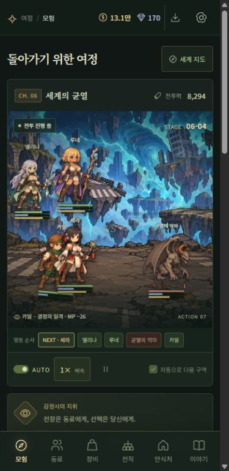

# 귀환의 감정사 · The Exiled Appraiser

- 게임 배포 주소: https://sejin0523.github.io/exiled-appraiser/
- GitHub 저장소: https://github.com/SEJIN0523/exiled-appraiser

이세계로 추방된 29세 회사원 서진이 감정안으로 동료의 잠재력을 알아보고 귀환의 길을 찾는 모바일 방치형 RPG입니다. **플레이 가능한 개발 버전(v0.6)**이며, 서버 없이 동작하는 설치형 웹앱(PWA)입니다.

## 바로 실행

Node.js 24 이상에서 프로젝트 폴더를 열고 실행합니다. 외부 npm 패키지는 필요하지 않습니다.

```sh
npm run dev
```

브라우저에서 http://127.0.0.1:5173 을 엽니다. 파일을 더블 클릭하는 `file://` 실행은 ES 모듈과 PWA가 동작하지 않습니다.

## 구현된 플레이

- 전위 우선 근접 공격, 후위 보호 피해 20% 감소, 후위 근접 공격 효율 20% 감소
- 좌우 진형 턴 전투, 돌진/피격/회복/치명타 연출, 우두머리
- 물리/마법 공격·방어 분리, 행동 속도 기반 순서와 빈도, 명중·회피 판정
- 전투 시간에 비례한 MP 자동 회복, 소모가 다른 약한/강한 기술, 성격 기반 전투 AI
- 8종 무기별 독립 숙련도와 성장 효과, 환생 후 유지, 방치 중 숙련 보상
- 자동 전투, 수동 턴 진행, 1/2/4배속, 일시정지, 다음 구역 자동 진행 또는 현재 구역 반복
- 주인공 지원: 감정안(약점 간파), 전술 지휘, 생명 공명
- 혼자 시작하는 5장면 프롤로그, 손목시계 매각 800 G → 무작위 성인 여성 노예 계약 구매 120 G
- 추가 계약 동료 10명, 전위 4칸 + 후위 4칸 중 최대 5명 출진
- 타이틀(새로 시작/이어서/종료) → 거점 → 명시적인 원정 시작, 화면별 탭과 목록 페이지
- 대화·편성의 상반신 초상화, 프로필 전신 갤러리와 전직 전 외형 보관
- 잠재력 A/S/SS, 9,999레벨, 균형/공격/방어 육성, 49개 직업과 선행 직업 조건
- 피부색을 보존하는 고정 의상 배색 바리에이션, 전투/초상화/전직 미리보기 일괄 반영
- 고정되는 고유 특성: 성격, 키, 몸매, 가슴 크기, 가치관, 행동/관계 성향, 선호/비선호 선물
- 성격별 대사, 선물 취향별 신뢰 증가량(좋아함 +15 / 보통 +10 / 비선호 +5), 고유 전투 재능
- 12종 전리품 × 4등급, 도달 구역 기반 무작위 성능, 감정/착용/분해, 무기/방어구 무제한 강화
- 30레벨 환생: 레벨 초기화, 영구 능력 배율 +25%p. 장비/직업/관계 유지
- 6개 지역 순환, 5구역마다 보스, 60구역마다 반복 세계. 수치상 최대 100만 구역까지 저장 지원
- 신뢰/선물/계약 해제/결혼. 계약 해제와 신뢰 100을 충족한 성인 동료의 자발적 관계
- 프롤로그부터 귀환까지 7편의 이야기 기록과 진행도에 따른 해금
- 15초 자동 저장, 수동 저장, JSON 내보내기/검증 후 가져오기
- 최대 8시간 방치 보상(이미 도달한 구역의 금화/경험치 40% 효율, 실제 원정 진행도는 증가하지 않음)
- 오프라인 캐시와 홈 화면 설치, 모바일 하단 메뉴, PC에서도 동일한 세로 프리뷰

자동 진행을 끄면 현재 구역을 반복합니다. 패배 시 한 구역 후퇴하고 다시 도전합니다. 자동 전투 자체를 끄면 **다음 턴** 버튼으로 진행합니다. 일시정지는 방치 보상도 중단합니다.

## 고정 외형 바리에이션과 고유 특성

외형은 영입할 때부터 정해진 캐릭터의 일부입니다. 플레이어용 색상 편집기와 전체 색조 필터는 제거했습니다. 같은 원본 캐릭터를 사용하는 동료도 고정된 의상 배색과 서로 다른 성격/재능으로 구분됩니다. 인간의 피부를 파랗거나 보라색으로 바꾸어 다른 종족이라고 표현하지 않습니다.

`portraits.js`의 소재 렌더러는 머리 영역, 눈, 따뜻한 피부색/가죽색, 중성 금속과 투명도를 유지하고, 머리 아래의 채도가 있는 차가운 계열 소재만 지정된 의상 배색으로 변환합니다. 원본의 음영과 질감을 유지합니다. 한 번 생성한 결과는 메모리에 캐시해 전투 중 반복 계산을 줄입니다. 종족의 형태 차이는 기존 원본에 있는 엘프 귀, 수인 귀/꼬리 등의 형태를 사용합니다. 새 귀 레이어를 생성한 버전은 아닙니다.

영입 가능 동료는 10명입니다. 아리아/리엔/미라/도윤은 기존 직업의 동일 원본을 사용하면서 다른 고정 의상 배색과 프로필을 갖습니다. 라비와 네리는 귀와 꼬리를 가진 기존 수인 에셋을 활용합니다. 신규 게임은 4가지 첫 동료 후보 중 한 명을 구매하며, 해당 회차에는 첫 동료 1명과 추가 계약 동료 10명을 육성할 수 있습니다. 이전 버전의 원정대는 기존 저장에 유지됩니다.

**동료 → 고유 특성 / 고유 외형**에서 확인하고, 영입 전에도 **고유 특성 감정**으로 프로필을 볼 수 있습니다. 성격과 취향은 대사와 선물 반응에, 전투 재능은 능력치에 반영됩니다. 몸매와 가슴 크기는 프로필 설정이며 별도 실루엣을 생성하지 않습니다.

v0.1~v0.3 저장은 레벨·장비·숙련도·관계를 보존하고 이전의 사용자 지정 전체 색조만 인물별 고정 외형으로 교정합니다. 색상은 전투 능력에 영향을 주지 않습니다.

## 안드로이드 세로 화면

설치형 PWA의 기본 방향을 `portrait`로 지정했습니다. 네이티브 APK가 아닌 Android Chrome 설치형 웹앱입니다. 일반 브라우저 탭은 OS의 화면 방향 설정을 따르고, 설치 후 세로 방향 요청이 적용됩니다. 실제 Android 기기 설치 검증은 별도로 필요합니다.

PC에서도 최대 480px의 세로 프레임으로 표시하며 데스크톱 사이드바는 표시하지 않습니다. 320/360/390 CSS px를 기준으로 검사합니다. 작은 화면에서는 전투 진형을 좌우 각 2열로, 원정대를 2열 카드로, 장비와 긴 설정을 한 열로 표시합니다. 텍스트는 한국어 단어 단위로 자연스럽게 줄을 바꾸고, 수치와 짧은 버튼 문구는 한 줄로 유지합니다. 큰 수치는 만/억 단위로 축약 표시하되 저장 수치는 바꾸지 않습니다. 주요 조작은 44px 이상의 높이를 사용하고, 상단 설정 버튼과 하단 안전 영역을 확보합니다.

## 전투 능력치 · 마나 · 무기 숙련도

**동료 → 전투 능력과 전술**에서 전체 능력치, 기술 위력/MP 비용, 기본 무기, 전투 방침, 무기별 숙련도를 확인하고 조정합니다. 전투에는 HP(초록), MP(파랑), 행동 게이지(금색)와 다음 행동 순서가 표시됩니다. 전투 기록에는 사용 기술, MP 소모, 피해/회복/회피를 표시합니다.

### 능력치와 판정

- 힘 → 물리 공격, 지능 → 마법 공격/최대 MP, 체력 → HP/물리 방어, 정신 → 마법 방어/MP 회복, 기교 → 명중/치명타, 민첩 → 행동 속도/회피.
- 직업의 역할, 잠재력, 레벨, 환생, 장비, 육성 방침과 전투 재능이 능력치에 반영됩니다. 체형과 색상은 영향을 주지 않습니다.
- 명중 확률은 `명중 − 대상 회피`이며, 마법은 +5%p 보정을 받습니다. 최종 확률은 10~99.5%로 제한합니다. 빗나가도 MP는 소모됩니다.
- 피해는 `공격 × 기술 위력 × 기준값 / (기준값 + 방어 × 1.8)`을 사용합니다. 기준값은 `90 + 공격자 레벨 × 4`입니다. 물리는 물리 공격/방어, 마법은 마법 공격/방어를 사용하고, 치명타는 ×1.7, 피해 편차는 ±10%입니다. 지휘/감정안 보너스도 적용됩니다.
- 행동 간격은 `100 / 행동 속도`의 전투 시간입니다. 아군/적 번갈아 고정하는 방식에서 바뀌었으며 빠른 캐릭터는 실제로 더 자주 행동합니다. 죽은 캐릭터는 행동 순서와 MP 회복에서 제외됩니다.

### 마나와 성격별 판단

각 전투는 최대 MP의 40%로 시작합니다. 살아 있는 전투원은 같은 경과 전투 시간에 자신의 MP 회복 수치를 곱해 충전합니다. 일시정지 중에는 행동·마나·재사용 대기가 함께 멈춥니다. 배속은 전투 진행을 가속합니다. MP가 부족하면 무료 기본 공격으로 싸우며 마나를 모읍니다.

| 역할 | 무료 기본 공격 | 약한 기술 | 강한 기술 |
| --- | --- | --- | --- |
| 물리 | 기본 공격 ×1.0 | 연속 타격 · MP 9 · ×1.5 | 결정의 일격 · MP 26 · ×2.9 |
| 마법 | 마력 투사 ×0.8 | 마력탄 · MP 12 · ×1.65 | 붕괴의 술식 · MP 34 · ×3.8 |
| 치유 | 빛의 투사 ×0.85 | 미광 치유 · MP 12 · ×1.65 | 생명의 기도 · MP 30 · ×3.4 |

호쾌한/과묵한 성격은 강한 기술을 위해 저비용 기술을 아끼고, 명랑한 성격은 약한 기술을 자주 사용합니다. 신중한 성격은 MP 20%를 남기려 하고, 무뚝뚝한 성격은 남은 HP가 적은 적에게 필요한 만큼의 기술을 씁니다. 온화한 성격의 치유사는 아군 HP가 85% 아래일 때부터 치료를 우선합니다. 과감한 성격의 치유사는 더 위급할 때까지 공격을 이어갑니다. 장난기 많은 성격은 강약을 섞으며 솔직한 성격은 공격 능력이 높은 적을 노립니다. 전투 방침을 직접 지정하면 성격의 기본 방침을 덮어쓸 수 있습니다.

현재 기술은 직업의 공격/마법/치유 역할별 공통 기술입니다. 직업마다 완전히 다른 기술 목록이나 광역 마법/상태이상은 후속 확장 항목입니다.

### 무기 숙련도

검·창·지팡이·장궁·단검·마도서·전투장갑·석궁을 각각 따로 익힙니다. 기본 무기를 선택할 수 있고, 전리품 무기를 장착했다면 장착한 무기 종류가 우선합니다. 전리품의 종류는 고정되어 있으며 다른 종류의 숙련도는 그대로 보관됩니다.

- 기본 공격 적중: 숙련 EXP +4, 기술/치유 사용: +8, 빗나감: +2.
- 숙련 레벨은 `floor(sqrt(누적 EXP / 20))`, 최대 1,000입니다.
- 현재 무기 숙련 레벨당 물리·마법 공격 +0.3%, 명중 +0.02%p. 지팡이/마도서로 마법을 쓰면 최대 20%까지 MP 비용이 줄어듭니다(소수 비용은 올림).
- 무기 종류별 기본 특성도 적용됩니다. 단검/장궁/장갑은 빠르며, 석궁은 명중이 높고 느립니다. 지팡이/마도서는 장비 위력이 마법 공격에 더 크게 반영됩니다.
- 숙련도, 기본 무기, 전투 방침은 저장/가져오기 및 환생 후 유지됩니다. 방치 보상에는 25초당 현재 사용 무기 숙련 EXP +2가 포함됩니다.

v0.1/v0.2 저장은 레벨·장비·관계·색상을 보존하며 숙련도와 기본 무기, 성격별 전투 방침을 보충합니다. 이전 전투는 현재 구역에서 새로 시작합니다.

## GitHub에서 수정하고 배포

- 게임: https://sejin0523.github.io/exiled-appraiser/
- 소스: https://github.com/SEJIN0523/exiled-appraiser

GitHub Pages는 **Deploy from a branch → main → /(root)** 방식입니다. GitHub 웹에서 `data.js`, `app.js`, `mobile.css` 등을 수정해 `main`에 커밋하면 Pages가 자동으로 다시 배포합니다. `.nojekyll`을 포함해 정적 파일을 그대로 서비스합니다.

별도 서버나 빌드 패키지는 필요하지 않습니다. 모든 게임 경로는 저장소 하위 주소에서도 동작하는 상대 경로입니다. 사용자 지정 Actions 워크플로는 `docs/github-pages-actions.example.yml`에 참고용으로 보관했습니다. 기본 배포에는 Actions 워크플로 파일이나 추가 OAuth workflow 권한이 필요하지 않습니다.

Android Chrome에서 게임 주소를 연 뒤 브라우저 메뉴의 **앱 설치**를 선택하세요. iPhone Safari는 **공유 → 홈 화면에 추가**를 사용합니다. 처음에는 게임 에셋 약 18MB를 캐시하므로 온라인 상태에서 완료해야 합니다. 저장은 기기·브라우저·사이트 주소별로 보관됩니다. 기존 로컬 게임에서 온라인 게임으로 진행을 옮기려면 설정에서 저장 파일을 내보내고 온라인 게임에서 가져오세요.

로컬에서도 `npm run dev`로 실행할 수 있으며, 이 폴더의 Git `origin`은 위 저장소로 연결됩니다.

## 검증

`npm run check`와 71개 자동 테스트가 통과했습니다. 브라우저에서 320/360/390px 세로 레이아웃, 훈련, 영입, 장비 감정/착용, 직업 필터, 저장 후 새로고침을 확인했습니다. 고정 외형 업데이트는 피부/머리/눈 보존, 의상 배색 차이, 이전 색상 저장 교정과 편집 메뉴 제거를 검사합니다. 전투 업데이트는 물리/마법 방어 분리, 속도에 따른 행동 빈도, 회피, 강약 마법의 MP 소모, 성격별 선택, 숙련도와 이전 저장 이관을 검사합니다. 실제 Android/iOS 기기 설치는 별도 확인이 필요합니다.



## 구조 및 확장

| 파일 | 역할 |
| --- | --- |
| `data.js` | 직업 계보, 지역, 동료, 이야기 콘텐츠 |
| `engine.js` | UI와 독립된 전투/육성/장비/저장 규칙 |
| `combat.js`, `combat.css` | 능력치, 행동 순서, 마나, 성격 AI, 무기 숙련도와 전투 UI |
| `character.js`, `character.css` | 고유 특성, 고정 의상 배색, 대사 및 프로필 화면 |
| `app.js` | 화면, 사용자 조작, 저장 타이머 |
| `style.css`, `mobile.css` | 반응형 UI, 세로 저해상도 레이아웃, 전투 애니메이션 |
| `portraits.js` | 피부와 머리를 보존하는 고정 소재 배색 렌더러 |
| `display.js` | 저해상도용 큰 수치 축약 표시 |
| `sw.js`, `manifest.webmanifest` | 설치, 오프라인 실행 |
| `tests/*.test.mjs` | 전투, 성장, 저장, 관계, 고정 외형과 모바일 배포 구성 검사 |
| `scripts/prepare-assets.py` | 원본 시트 분할/마젠타 키 투명화/WebP 최적화 |

```sh
npm run check
npm test
```

## 에셋

사용자가 지정한 `C:\CLAUDE\FIEF\design\output\` 에서 캐릭터, 몬스터, 배경, 마을, 스토리 에셋을 가공했습니다. 마젠타 배경을 제거하고 시트를 분할한 결과를 `assets/`에 포함해 다른 컴퓨터와 GitHub에서도 원본 경로 없이 실행할 수 있습니다. 새 메인 아트 `assets/key-art.webp`는 이 프로젝트를 위해 생성했습니다. 원본 에셋의 상업적 사용 권리는 원본 보유자가 확인해야 하며, 이 프로젝트는 별도 라이선스를 부여하지 않습니다.

## 첫 버전의 범위

이 버전은 확장 가능한 플레이 기반입니다. 장편 분기 시나리오, 동료별 데이트 이벤트, 결혼식 연출, 고유 직업 액티브 스킬, 장비별 전용 외형, 개별 던전, 클라우드 계정/저장 및 장기 밸런스 검증은 후속 개발 항목입니다. 직업은 현재 공격/수호/마법/치유 역할과 능력 배율로 구별되며, 모든 직업에 독립된 전투 AI가 있는 것은 아닙니다. 게임의 보상과 장비는 실제 결제 없이 게임 내 재화로만 획득합니다.

## v0.6 검증

프롤로그 5장면과 첫 계약 거래, 명시적 탐험 시작, 8칸/5인 편성, 전직 외형 기록을 검증합니다. 71개 자동 검증이 통과했습니다. 기존 저장은 소유 동료를 유지하며 진형과 외형 기록을 마이그레이션합니다. 과거 버전에서 이미 지나간 전직 외형은 기록되지 않았으므로 현재 직업부터 보관합니다. 브라우저에서는 OS의 뒤로/홈 버튼으로 앱을 닫습니다.


## v0.6 Phaser 운영 통합

전투 화면에 Phaser 3.90.0 정지 원화 렌더러를 적용했습니다. 실제 저장된 동료, 직업, 장비, MP, 무기 숙련과 전투 보상을 사용합니다. DOM 전투 대신 발 기준 정렬, 얼굴 폭 기준 크기 보정, 대기 움직임, 돌진·투사체·마법진·파티클, 피격 점멸·넉백·피해 숫자, 강타 히트스톱을 표시합니다.

전투 중 조작은 균형/총공세/생존 전술과 도주입니다. 지휘 능력도 자동 발동하며, 피해와 보상은 타격 순간에 한 번만 반영합니다. 도주하거나 화면을 떠나면 미해결 공격은 취소됩니다. 전위가 없으면 후위가 전투 화면에서 앞으로 이동하고 보호·원거리 배치 이점이 사라집니다. 저장된 편성 위치는 바꾸지 않습니다. 새 동료를 구매해도 기존 배치를 유지합니다.

연속 전투에서는 같은 지역·파티의 Phaser 게임과 텍스처를 재사용합니다. 지역 이동이나 화면 종료 시 GPU 리소스를 해제합니다. 런타임과 의존 모듈은 PWA 캐시에 포함되며, 기존 저장 키를 유지합니다. 별도 프로토타입은 `prototype/phaser/`에 남아 있습니다. 원래 작업 사본의 미완료 경제·도시 개편은 이번 렌더러 통합에 섞지 않았습니다.
